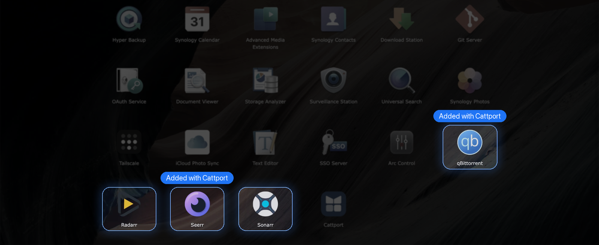

<p align="center"></p>

<h1 align="center">Cattport</h1>

<p align="center"><strong>All your Docker services and links, right in the Synology DSM menu.</strong><br>Add them in a few clicks, choose who sees them, and open everything from one place.</p>

<p align="center">
  <a href="https://github.com/morcatt-labs/cattport/releases/download/v1.0.0-beta.3/Cattport-1.0.0-0020.spk"></a>
</p>

<p align="center">
  <a href="#install">Install</a> ·
  <a href="docs/beta-testing.md">Testing checklist</a> ·
  <a href="https://github.com/morcatt-labs/cattport/issues/new/choose">Report a problem</a>
</p>

> [!NOTE]
> **Beta.** Tested only on DSM 7.4.1 so far, so other versions and models may not work yet. If something goes wrong, uninstall Cattport from Package Center.

## Install

Takes about a minute. You need an administrator account.

1. **Download** [`Cattport-1.0.0-0020.spk`](https://github.com/morcatt-labs/cattport/releases/download/v1.0.0-beta.3/Cattport-1.0.0-0020.spk).
2. In DSM, open **Package Center → Manual Install**, choose the file and finish the install.
3. Open **Cattport** from the main menu, add your apps and press **Save to DSM**.

If DSM refuses the file, go to **Package Center → Settings** and allow packages from any publisher.

## Your apps, right in the DSM menu

<p align="center"></p>

## See it

<table>
  <tr>
    <td></td>
    <td></td>
  </tr>
  <tr>
    <td></td>
    <td></td>
  </tr>
</table>

## What it does

- **Adds Docker services in a few clicks,** or any link you want
- **Finds icons for you** from the container or online, or use your own from your computer or File Station
- **Works locally and behind a reverse proxy,** with a separate local and domain address
- **Lets you choose who sees each app,** or hide it from the menu
- **Stays out of the way:** it runs nothing in the background and doesn't change Docker or your services
- **Speaks your language:** every language DSM supports, plus Romanian, in light and dark themes
- **Has you covered** with backup and restore, diagnostics and built-in help

## How saving works

Changes stay in Cattport until you press **Save to DSM**. Cattport then restarts itself once, which closes and reopens its window. Other users see the changes after they reload DSM.

## Good to know

- Needs an administrator account and Python 3 (`/usr/bin/python3`), which DSM 7.4 includes.
- "Only admins" and "Hide" only remove a tile from the menu. They don't protect the service behind it.
- Files in a DSM package can be read without signing in, including tile names and addresses. Don't put passwords or tokens in an address.
- Starting the package from Package Center, or updating it, also publishes changes you haven't saved yet.
- DSM saves desktop shortcuts when a page is reloaded or closed, so a new shortcut can take a moment to reach other browsers.

## Build from source

Needs Python 3 and Pillow.

```bash
python3 build_spk.py
python3 -m unittest test_core
python3 dev_server.py
```

The package is written to `dist/`. `dev_server.py` previews the interface locally, with DSM's answers simulated.

## License

© 2026 Morcatt Labs. The code is licensed under the GNU GPL version 3, see [LICENSE](LICENSE). The Cattport name and logo are not covered by that license.

Synology and DSM are trademarks of Synology Inc. Docker is a trademark of Docker, Inc. Other product names and logos shown in the images belong to their owners. Cattport is an independent project and isn't affiliated with or endorsed by any of them.
