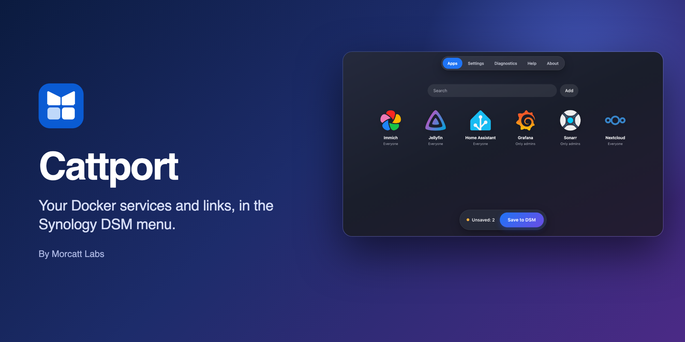
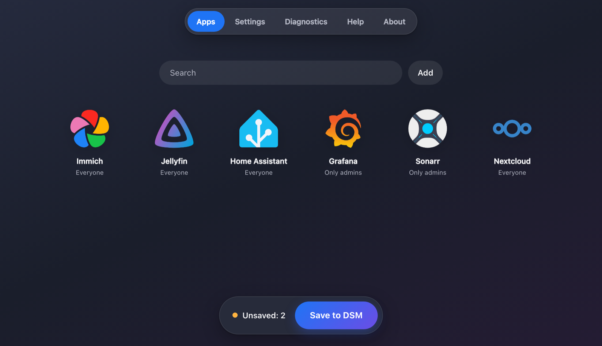
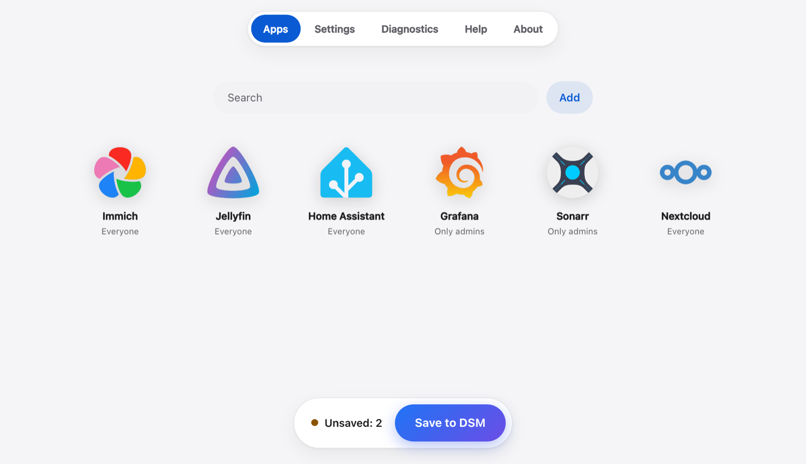
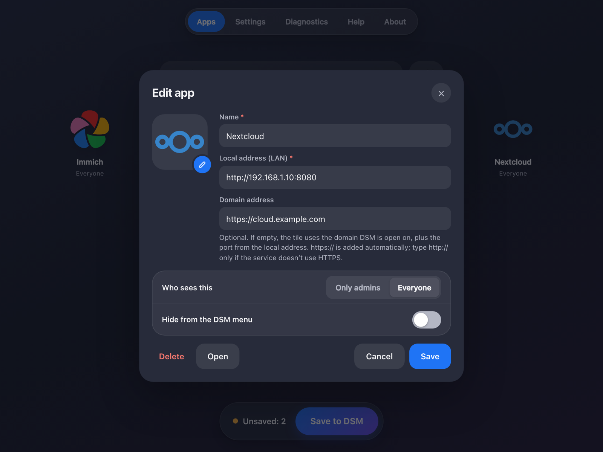
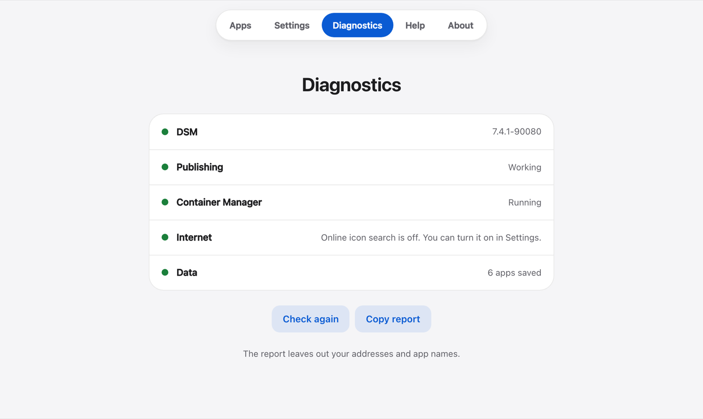

<p align="center"></p>

# Cattport

Put your Docker services and favorite links in the Synology DSM menu, next to your other apps.

Cattport only adds shortcuts. It doesn't change Docker, your containers or your services, and it runs nothing in the background.

> **Beta.** Tested only on DSM 7.4.1 so far, so other versions and models may not work yet. If something goes wrong, uninstall Cattport from Package Center. [Testing checklist](docs/beta-testing.md) · [Report a problem](https://github.com/morcatt-labs/cattport/issues/new/choose)

<table>
  <tr>
    <td></td>
    <td></td>
  </tr>
  <tr>
    <td></td>
    <td></td>
  </tr>
</table>

## Features

- Add running Docker services in a few clicks, or add any link
- Icons from the container, your computer, File Station or an image address, plus optional online search
- Separate local and domain addresses, so a tile also works behind a reverse proxy
- Choose who sees each tile, or hide it from the menu
- Light and dark themes, and every language DSM supports, plus Romanian
- Backup and restore, diagnostics and built-in help

## Install

1. Download the latest `.spk` from [Releases](https://github.com/morcatt-labs/cattport/releases).
2. In DSM, open **Package Center → Manual Install** and choose the file. If DSM refuses it, set the trust level in **Package Center → Settings** to allow any publisher.
3. Open **Cattport** from the main menu.

## How saving works

Changes stay in Cattport until you press **Save to DSM**. Cattport then restarts itself once, which closes and reopens its window. Other users see the changes after they reload DSM.

## Good to know

- Needs an administrator account and Python 3 (`/usr/bin/python3`), which DSM 7.4 includes.
- "Only admins" and "Hide" only remove a tile from the menu. They don't protect the service behind it.
- Files in a DSM package can be read without signing in, including tile names and addresses. Don't put passwords or tokens in an address.
- Starting the package from Package Center, or updating it, also publishes changes you haven't saved yet.
- DSM saves desktop shortcuts when a page is reloaded or closed, so a new shortcut can take a moment to reach other browsers.

## Build from source

Needs Python 3 and Pillow.

```bash
python3 build_spk.py
python3 -m unittest test_core
python3 dev_server.py
```

The package is written to `dist/`. `dev_server.py` previews the interface locally, with DSM's answers simulated.

## License

© 2026 Morcatt Labs. The code is licensed under the GNU GPL version 3, see [LICENSE](LICENSE). The Cattport name and logo are not covered by that license.

Synology and DSM are trademarks of Synology Inc. Docker is a trademark of Docker, Inc. Other product names and logos shown in the screenshots belong to their owners. Cattport is an independent project and isn't affiliated with or endorsed by any of them.
